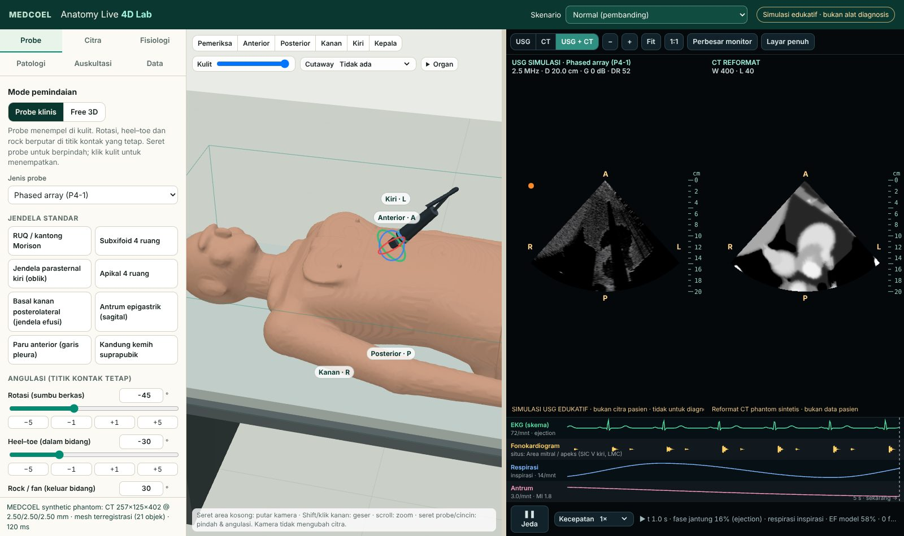

# MEDCOEL Anatomy Live 4D Lab

An educational freehand CT / simulated-ultrasound workstation for MEDCOEL (`/anatomy/live`).
**Simulation for teaching only. Not patient data, not for diagnosis, not a medical device.**



## Anatomy: the MEDCOEL Anatomy Atlas (default)
- The patient's organs, bones and vessels are the **same models as the MEDCOEL Anatomy Atlas** (`/anatomy/viewer/`),
  loaded from the atlas's own files (no copies) and placed with one explicit, exact frame (metres → LPS mm).
- The CT and tissue labels the simulator images are **synthetic, generated from those atlas meshes**
  (`pipeline/atlas/build_atlas_dataset.mjs`), so the heart you see in 3D is the heart in the CT/US image.
  It is not an acquired image of any person.
- The atlas has no skin. The body surface is an **illustrative shell** derived from the atlas muscle/bone envelope
  plus an assumed fat/skin thickness; it is labelled as such and used for probe contact.
- **Anatomi** tab: display modes (external body, transparent skin, anatomical cutaway, internal anatomy, imaging
  coverage), atlas systems with transparency, search / highlight / isolate / hide, "pick in 3D", a legend separating
  atlas anatomy, procedurally animated anatomy and imaging-derived content, and the coordinate-frame/registration panel.
- The earlier procedural phantom is still available (`?dataset=phantom`, or the Data tab). It is a different body
  and is **not** registered to the atlas (measured residual RMS ≈ 37 mm), so the atlas is never overlaid on it.
- Details and evidence: `ATLAS_INTEGRATION_AUDIT.md`.

## What you can do
- **Recognisable virtual patient** on an exam table. The skin and 20 organ groups are reconstructed from the CT with verified
  registration (affine, CT probes, SHA-256, anchors). It has anterior/posterior/lateral/head views, orientation labels, a CT
  coverage box, transparent skin, an anterior cutaway and a cutaway along the image plane.
- **Clinical probe mode**: click or drag the probe on the skin. Rotation, heel–toe and rock pivot about a fixed contact point,
  controlled by 3D rings, sliders and exact numeric inputs. Eight standard windows (subxiphoid, parasternal, apical, RUQ,
  effusion window, epigastric antrum, anterior lung, bladder). Linear, curvilinear and phased-array probes.
- **Free 3D mode**: an unconstrained 6-DOF plane. Translation arrows and rotation rings, numeric position and angles with
  0.1/1/10 mm and 0.1/1/15° precision, axial/coronal/sagittal/oblique presets, and an out-of-volume banner.
- **Imaging monitor**: US, CT or side-by-side. Zoom, pan, fit, 1:1, resizable divider, expanded and fullscreen modes, depth
  scale, patient-direction letters, CT window/level presets.
- **Simulated ultrasound** (`src/sim/ultrasound.js`): impedance reflection, attenuation, speckle, shadowing, reverberation,
  posterior enhancement, frequency, depth, gain, TGC and dynamic range. Tissue parameters are editable live.
- **Motion** (procedural): cardiac cycle with HR and phase control, respiration with rate, depth and breath hold, and gastric
  antral peristalsis with frequency, amplitude and speed. Meshes and images use the same displacement field.
- **Pathology**: reduced LV systolic function (HFrEF pattern), right pleural effusion, reduced antral motility. Each has a
  normal-vs-pathological toggle, a suggested window, findings and references.
- **Auscultation**: stethoscope tool and 15 sites, synthesised S1/S2 with physiological splitting, S3 in HFrEF, breath and
  bowel sounds, bell/diaphragm filter, and a phonocardiogram strip synchronised with a schematic ECG.

## Run locally
```bash
cd apps/4d-lab
npm ci
npm run dev          # http://127.0.0.1:4180/
npm test             # unit tests
npm run build && npm run test:e2e   # browser tests (Playwright Chromium)
```
Bundled data: `public/data/atlas` (default, atlas-derived; regenerate with `npm run atlas:dataset`, ~70 s, needs
`apps/anatomy/public/models`) and `public/data/phantom` (procedural; `npm run phantom`). In dev, Vite serves
`apps/anatomy/public` at `/anatomy/viewer/`. Browser tests: `npm run build && npm run test:e2e` (phantom regression)
and `npm run test:e2e:atlas` (atlas dataset; add `--shots` for evidence screenshots).
For CTACardio, see `pipeline/README.md` (local processing only).

## Documentation
| File | Content |
|---|---|
| `PHASE_STATUS.md` | Phase gates, evidence, open items, where to resume |
| `ROADMAP.md` | Phases and gates |
| `TEST_RESULTS.md` | Commands, results, measured values, manual Safari checklist |
| `INTEGRATION.md` | Safe deployment plan for medcoel.com (`/anatomy/live`, `/anatomy/4d-lab/`) |
| `MEDICAL_REFERENCES.md` | Sources for scenario text and tissue constants |
| `ASSET_LICENSE_REGISTRY.md` | Every shipped asset and the datasets that must not be included |
| `RELEASE_READINESS.md` | Local staging preview (Safari on macOS), test report, owner checklist, licence status, rollback, deployment plan |
| `MEDICAL_REVIEW_CHECKLIST.md` | Every item that needs clinical/anatomical review before release |
| `ATLAS_INTEGRATION_AUDIT.md` | Atlas inventory, frames, licences, mesh findings, registration decision, performance |
| `pipeline/README.md` | Phantom generator and the local CT → mesh route (VTK / 3D Slicer) |
| `CLAUDE.md` | Engineering rules for future sessions |
| `legacy/v0.9/` | The previous prototype, preserved with its tests |

## Code map
`src/core` geometry (NRRD, affine sampling, probe kinematics, reslice, GLB registration) ·
`src/sim` tissues, ultrasound, physiology, pathology, auscultation, views, references ·
`src/app` three.js scene, shared atlas layer + Anatomi panel, monitor, audio, imaging worker, controller · `pipeline/atlas` atlas-derived dataset builder · `pipeline` Python tools · `test` unit and e2e tests.
